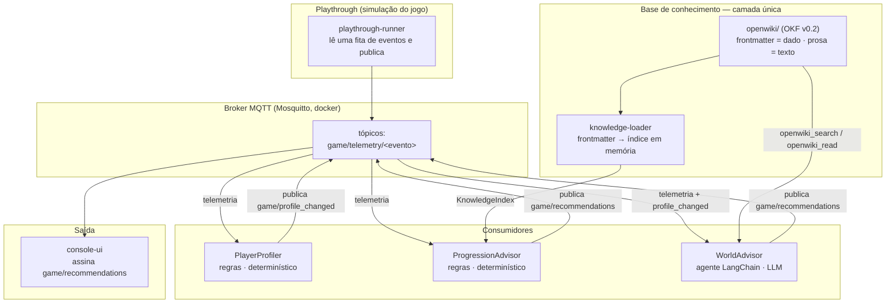

# ARCHITECTURE · Game Copilot

> Arquitetura e componentes do sistema da aula 2. Escopo e decisões em [SCOPE.md](./SCOPE.md) · roteiro em [PRESENTATION.md](./PRESENTATION.md).
> Stack: TypeScript strict · Vitest · Mosquitto (MQTT) · LangChain.js · OpenWiki (OKF v0.2) · OpenCode + Skills do Matt Pocock como processo de desenvolvimento.

## 1. Visão geral



Princípios:

- **Um só contrato de evento** governa todos os consumidores — a spec define o evento, e regras e agente coexistem no mesmo tópico.
- **Determinismo onde importa**: profiler e progression advisor são agregação/regras (testáveis, instantâneos). O LLM entra apenas onde linguagem natural agrega valor (WorldAdvisor).
- **A wiki é a única fonte de conhecimento**: o frontmatter OKF alimenta o motor; a prosa alimenta o agente. Não existe `graph.ts` paralelo (impossível haver drift entre as camadas).

## 2. Componentes do sistema

### 2.1 `playthrough-runner` (a "fita" do jogo)

- Lê um arquivo de playthrough (`src/playthroughs/<perfil>.ts`) contendo uma sequência de eventos com timestamps e publica cada um no `EventBus`, respeitando o intervalo entre eles.
- Representa o "jogo rodando" — no mundo real, seria o componente que captura a telemetria da tela de jogo (fora de escopo nesta aula).
- 3 fitas oficiais: `casual.ts`, `completionist.ts`, `speedrunner.ts` (§6).

### 2.2 `event-bus` (a seam do sistema)

- **Interface `EventBus`**: `publish(topic, event)` / `subscribe(topic, handler)`, tipada por evento.
- **`InMemoryEventBus`**: usado nos testes e no demo sem docker. Permanece após a etapa 07 — a interface é o que permite trocar o transporte sem tocar nos consumidores (lição da etapa 07: a seam acordada na spec).
- **`MqttEventBus`** (etapa 07): implementação sobre `mqtt.js` conectada ao Mosquitto; mapeia eventos para tópicos (§4).

### 2.3 `player-profiler` (determinístico)

- Assina a telemetria, mantém o estado do jogador e **publica `game/profile_changed`** quando a inferência muda.
- Perfis: `casual`, `completionist`, `speedrunner`. Sinais (todos derivados dos eventos + timestamps):

| Perfil | Sinais de inferência |
|---|---|
| `casual` | Poucas áreas visitadas; níveis concluídos sem secret exits; longos intervalos entre eventos; `inventory_opened` frequente (consulta mais do que coleta) |
| `completionist` | Dragon Coins e secret exits frequentes; `inventory_opened` para inspecionar; revisita áreas; coleta power-ups variados |
| `speedrunner` | Deltas curtos `level_started → level_completed`; direto ao castelo/objetivo; quase nenhum desvio nem secret exit; volume alto de eventos por minuto |

- A inferência é **agregação com regras declaradas** ( thresholds simples, ordenados por força do sinal) — o perfil não é decidido por LLM.

### 2.4 `progression-advisor` (determinístico)

- Assina telemetria + `game/profile_changed`, consulta o `KnowledgeIndex` e publica em `game/recommendations`.
- Regras típicas (v1):
  - **Próximo objetivo por perfil**: casual → próximo castelo no caminho principal; completionist → segredo faltante na área atual; speedrunner → rota mais curta até o próximo boss.
  - **Gating detectado**: chegou numa área cujo acesso depende de Switch Palace/saída secreta não concluída → recomenda concluir o pré-requisito (o *momento da demo*: Forest of Illusion, §6).
  - **Power-up**: antes de `boss_engaged`, sugere o power-up certo se o inventário não o tem (ex.: Cape Feather para castelo).

### 2.5 `world-advisor` (agente LangChain — etapa 08)

- **O que é**: agente LLM que é mais um consumidor do broker. Recebe telemetria + perfil, **consulta a wiki** e publica recomendações ricas em linguagem natural.
- **Ferramentas**: `openwiki_search` / `openwiki_read` (ferramentas locais, read-only, sem chamada de modelo do OpenWiki) ou leitura direta das páginas `openwiki/` — decisão acordada na spec da feature.
- **Quando reage** (non-goal: reagir a cada evento): `area_entered` (o que este mundo esconde), `boss_engaged` (power-up/estratégia), `profile_changed` (reorienta as dicas). Throttle por sessão.
- **Contrato de saída** (schema validado): a recomendação deve citar a página da wiki que fundamenta a dica (`evidence`) — *guardrail: não inventar segredo que não está na wiki*.
- **Evals**: conjunto de casos (evento + perfil → dica esperada) rodado fora do caminho crítico; a spec da feature os define.
- Provider LLM: endpoint OpenAI-compatible (ex.: GLM), configurável — decisão da spec da feature.

### 2.6 `knowledge-loader` + `openwiki/` (a camada de conhecimento)

- **`openwiki/`**: a base de conhecimento dos **jogos**, no formato **OKF v0.2** (markdown com frontmatter estruturado + evidências), commitada no repo e **organizada por título do jogo** (`openwiki/<game-slug>/` — ex.: `super-mario-world/`). Jogo novo no futuro = pasta nova com o schema do jogo; os advisors consomem a wiki sem saber de qual jogo. Gerada/curada a partir de detonados (autoria com OpenCode + OpenWiki — offline, pré-gravação). **A wiki contém apenas conhecimento de jogo** — a documentação do projeto vive nos docs da raiz (`SCOPE.md`, `ARCHITECTURE.md`, `AGENTS.md`).
- Exemplo de página de nível:

```markdown
---
type: level
id: forest-of-illusion-4
name: Forest of Illusion 4
area: forest-of-illusion
kind: main
exits:
  - kind: normal
    goes-to: forest-of-illusion-3
  - kind: secret
    goes-to: forest-secret-area
    requirement: keyhole
prerequisites: [forest-of-illusion-2]
rewards: [dragon-coin]
boss: false
---
Atrás do bloco "!" há uma keyhole escondida... (prosa que o agente lê)
```

- **`knowledge-loader`**: varre `openwiki/`, faz parse do frontmatter e monta o **`KnowledgeIndex`** em memória (áreas, níveis, exits, pré-requisitos, recompensas, power-ups). É o que o `ProgressionAdvisor` consulta — determinístico e testável.
- **`INSTRUCTIONS.md`/schema da wiki** (regras do OpenWiki) é a **spec da base**: define os tipos de página (`area`, `level`, `power-up`, `boss`, `switch-palace`) e os campos obrigatórios do frontmatter. O corpo em prosa é o que o agente consome.
- **`openwiki visualize`** gera o grafo interativo do mundo — material do slide.

### 2.7 `console-ui`

- Assina `game/recommendations` e imprime formatado, marcando a origem:

```text
[12,4s] area_entered  forest-of-illusion
  ▸ ProgressionAdvisor (perfil: casual)
    Você está dando voltas na Forest of Illusion. A saída para o próximo mundo
    é o secret exit da Forest of Illusion 4.
  ▸ WorldAdvisor (agente · wiki: forest-of-illusion-4)
    Procure a keyhole atrás do bloco "!" — leve a Cape Feather para atravessar
    a área alta sem tomar dano.
```

### 2.8 Infra

- `docker-compose.yml`: serviço `mosquitto` (porta 1883, config mínima). Única dependência de runtime fora do npm.

## 3. Estrutura de pastas (proposta — NestJS com camadas DDD)

```text
dio-spec-driven-development-hands-on/
├── docker-compose.yml               # Mosquitto (etapa 07) + OpenObserve (etapa 06)
├── package.json / tsconfig.json / vitest.config.ts
├── AGENTS.md / CODING_STANDARDS.md / GLOSSARY.md / docs/agents/
├── docs/openwiki-setup.md           # guia de setup da base de conhecimento
├── knowledge/sources/               # digests das fontes (detonado, SM Wiki)
├── openwiki/                        # base de conhecimento dos jogos (OKF v0.2)
│   ├── INSTRUCTIONS.md              # brief: apenas conhecimento de jogo, multi-jogo
│   ├── quickstart.md                # índice dos jogos + retrieval
│   └── super-mario-world/           # um jogo por pasta (slug do título)
│       ├── schema.md                # tipos de página e campos do jogo
│       ├── world-map.md             # esqueleto curado + gating
│       ├── areas/ · levels/ · power-ups/ · bosses/ · switch-palaces/
│       └── index.md
├── .github/workflows/ci.yml         # CI: typecheck + test + check:wiki
└── src/
    ├── domain/                      # PURO, sem Nest — entidades e regras
    │   ├── events/                  # os 5 tipos canônicos + envelope
    │   ├── profiler/                # regras de inferência de perfil (funções puras)
    │   └── progression/             # regras de progressão (sobre o KnowledgeIndex)
    ├── application/                 # Nest services (orquestração)
    │   ├── event-bus/               # EventBus sobre EventEmitter2 (@nestjs/event-emitter)
    │   ├── profiler/                # PlayerProfiler service (@OnEvent)
    │   └── advisor/                 # ProgressionAdvisor service (@OnEvent)
    ├── infrastructure/              # adapters
    │   ├── knowledge/               # loader OKF → KnowledgeIndex
    │   ├── mqtt/                    # MqttEventBus (etapa 07 — migração gravada)
    │   ├── world-advisor/           # agente LangChain (etapa 08 — gravada)
    │   └── otel/                    # observabilidade (etapa 06)
    ├── game/                        # playthrough-runner: as 3 fitas de eventos
    └── presentation/                # console-ui
├── scripts/check-wiki.mjs           # validador do schema da wiki (CI)
└── test/                            # suíte (vitest)
```

## 4. Contratos

### 4.1 Eventos de telemetria (publicados em `game/telemetry/<tipo>`)

| Tipo | Payload (`data`) | Notas |
|---|---|---|
| `area_entered` | `{ area: AreaId }` | areas: `yoshis-island`, `donut-plains`, `forest-of-illusion`, `chocolate-island`, `valley-of-bowser`, `star-road`, `special-zone` |
| `level_started` | `{ level: LevelId }` | |
| `level_completed` | `{ level: LevelId, exit: "normal" \| "secret" \| "keyhole", durationMs: number }` | `durationMs` alimenta o sinal de speedrunner |
| `inventory_opened` | `{ reason: "check" \| "collect" }` | sinal de perfil |
| `boss_engaged` | `{ boss: BossId, level: LevelId }` | castelos/fortalezas |

Envelope comum de todo evento: `{ type, sessionId, ts, data }`.

### 4.2 Eventos derivados

| Tópico | Publicado por | Payload |
|---|---|---|
| `game/profile_changed` | PlayerProfiler | `{ profile: "casual" \| "completionist" \| "speedrunner", confidence: number, signals: string[] }` |
| `game/recommendations` | ProgressionAdvisor, WorldAdvisor | `{ source: "progression-advisor" \| "world-advisor", profile, message: string, evidence: { wikiPage?: string, events: string[] } }` |
| `game/agent/observed` *(opcional)* | WorldAdvisor | observações do agente como evento (padrão extensível) |

### 4.3 Glossário (semilla para o `GLOSSARY.md` das skills)

- **Fita de playthrough**: sequência de eventos que simula uma sessão de jogo.
- **Telemetria de gameplay**: os eventos publicados pelo jogo no broker.
- **Gating**: pré-requisito que bloqueia acesso (Switch Palace, keyhole, boss derrotado).
- **Secret exit / keyhole**: saída alternativa de uma fase (alimenta completionist e Star Road).
- **Switch Palace**: ativa blocos "!" que desbloqueiam caminhos.
- *Avoid*: "quest" (Mario tem fases/objetivos, não quests), "batalha" (boss_engaged), "grafo tipado" (a wiki é a única camada).

## 5. Mundo de Super Mario World (esqueleto curado)

> **Fontes**: detonado **PC do Paulo** (PT-BR, ingestão primária) + **Super Mario Wiki** (validação canônica do gating — página *Secret exit*). Escolha registrada no Ticket #2 da etapa 01.
>
> | Fonte | Uso | Link |
> |---|---|---|
> | PC do Paulo — Detonado Super Mario World (2024, PT-BR) | **Ingestão primária** (texto completo, secret exits e Star World) | <https://www.pcdopaulo.com/2024/09/detonado-super-nintendo-super-mario.html> |
> | Super Mario Wiki — *Secret exit* | **Validação canônica do gating** (as 24 saídas secretas) | <https://www.mariowiki.com/Secret_exit> |
> | Super Mario Wiki — *Super Mario World* | Validação por nível/área | <https://www.mariowiki.com/Super_Mario_World> |
> | YouTube — Todas as Saídas Secretas | Referência visual das rotas | <https://www.youtube.com/watch?v=KjhSUdv5Lwo> |

Estrutura real simplificada para caber em aula (~5 áreas principais + camada secreta). As evidências exatas de cada página vêm do detonado na autoria da wiki.

| Área | Conteúdo | Papel no gating |
|---|---|---|
| **Yoshi's Island** (hub) | Fases 1–4, Yoshi's House, **Iggy's Castle** | Tutorial; boss libera Donut Plains |
| **Donut Plains** | Fases 1–4, **Green Switch Palace**, Donut Secret 1 (keyhole → **Star Road**), **Ludwig's Castle** | Switch Palace desbloqueia blocos "!" nos mundos seguintes; boss libera Forest of Illusion |
| **Forest of Illusion** | Fases com **múltiplas saídas** (labirinto: sem a saída secreta certa, repete-se a área), **Blue Switch Palace**, **Roy's Castle** | O **momento da demo**: casual entra em loop na floresta |
| **Chocolate Island** | Fases, Chocolate Secret, **Wendy's Castle** | Boss libera o acesso ao Valley of Bowser |
| **Valley of Bowser** | Fases 1–4, **Larry's Castle** (final) | Fim do caminho principal |
| **Star Road → Special Zone** | Acesso só por **secret exits/keyholes**; 8 níveis especiais | Conteúdo do completionist; expansão do homework (`feature/09`) |

Power-ups como "equipamento": **Cape Feather** (voo — ideal para castelos), **Fire Flower**, **Yoshi** — o `WorldAdvisor`/ProgressionAdvisor sugerem qual levar ao `boss_engaged`.

## 6. Sequências de demo (as 3 fitas)

| Fita | Roteiro de eventos | Saída esperada no console |
|---|---|---|
| **casual.ts** | Caminho principal, sem segredos, inventário consultado com frequência, pausas longas | Perfil `casual`; ao entrar na Forest of Illusion, **loop**: ProgressionAdvisor detecta o gating e aponta a saída secreta; WorldAdvisor enriquece com a wiki (keyhole + power-up) |
| **completionist.ts** | Secret exits, Switch Palaces, Dragon Coins, inventário constante, revisita áreas | Perfil `completionist`; dicas do que falta coletar por área; caminho para a Star Road |
| **speedrunner.ts** | Deltas curtos, direto aos castelos (Iggy → Ludwig → Roy → Wendy → Larry), zero desvios | Perfil `speedrunner`; ProgressionAdvisor dá o próximo objetivo; WorldAdvisor sugere rota otimizada |

`npm run demo` executa as três em sequência (ou por parâmetro) contra o broker Mosquitto (etapa 07 em diante) — antes disso, roda com `InMemoryEventBus`.

## 7. Testes

- **Unitários por componente** com `InMemoryEventBus` e fitas mínimas: profiler (sinais → perfil), progression (gating → recomendação), loader (frontmatter → índice; campo faltante = erro de schema da wiki).
- **Contrato de eventos**: schema/tipo compartilhado — quebrar o payload quebra o build.
- **Evals do agente** (etapa 08): casos evento+perfil → dica esperada, com as páginas da wiki como gabarito; fora do caminho crítico.
